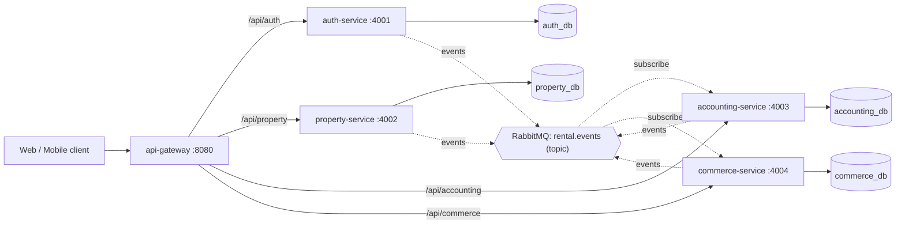

# Architecture

## Key decisions (ADR-style)

| # | Decision | Why |
|---|---|---|
| 1 | Database per service (one Postgres instance, separate DBs) | Loose coupling; each service owns its schema. You can split instances later. |
| 2 | Async integration via RabbitMQ topic exchange | Services stay independent and can be temporarily offline. Routing key = event name. |
| 3 | Stateless JWT, verified in every service | The gateway stays simple, and an internal call can't skip authorization. |
| 4 | Raw SQL with `pg` plus SQL migration files | Explicit and easy to review; no ORM magic for AI agents to misread. |
| 5 | Idempotent consumers (`processed_events`) | RabbitMQ delivers at least once, so duplicates are expected. |
| 6 | Local read-models (e.g. `lease_billing`) | Avoids synchronous cross-service calls on hot paths. |
| 7 | Publish after commit (no outbox yet) | Simple for now. Known gap: if the process crashes between commit and publish, the event is lost. **Future:** transactional outbox. |

## Known limitations / roadmap
- Transactional outbox pattern for guaranteed publishing.
- Dead-letter queue configuration and retry with backoff.
- Automated tests (unit with vitest, integration with testcontainers).
- Refresh tokens, password reset.
- Payment provider integration (VNPay, MoMo, Stripe) in accounting-service.
- Tenant portal (map `tenants.user_id` from `auth.user.registered`).
